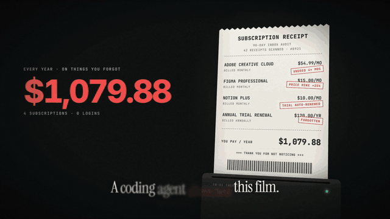
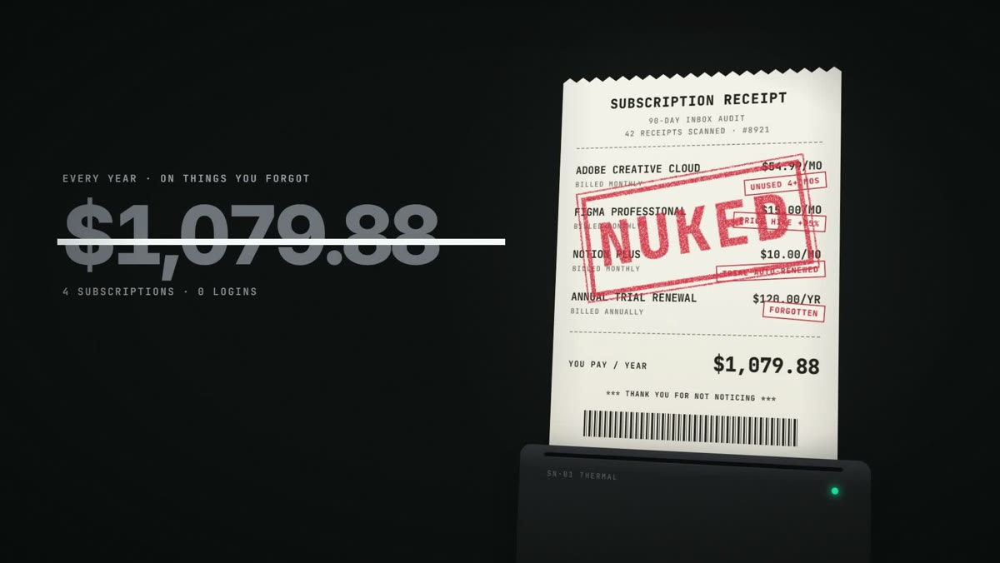
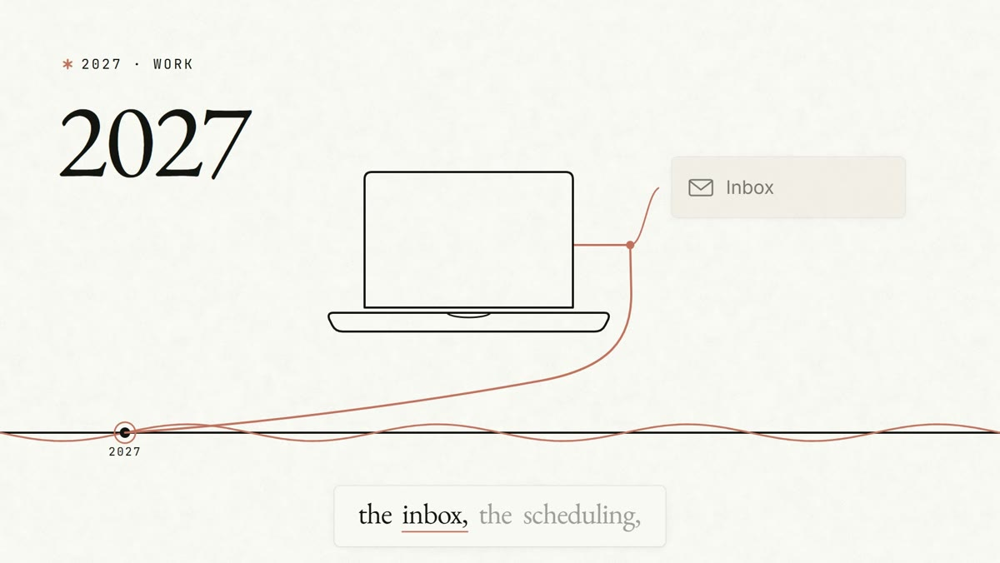

# TeaserKit

**The director for your coding agent's videos.** Ask Claude Code, Codex or Cursor for a launch film,
and TeaserKit makes it look directed instead of generated.

[teaserkit.com](https://teaserkit.com) · [How it compares](https://teaserkit.com/guides/launch-video-tools-for-coding-agents) · [Setup guide](https://teaserkit.com/setup) · [Product Hunt](https://www.producthunt.com/products/teaserkit)



> This repository is TeaserKit's public home page: what it does, how to install it, and examples.
> The director itself is a paid product, sold at [teaserkit.com](https://teaserkit.com).

## Free skill: launch video checklist

This repo includes a free Agent Skill anyone can use: the director's checklist TeaserKit runs on every
film. It covers the concept, one style, reading time, stillness, cuts, music, sound on motion,
loudness and on-screen claims, with ffmpeg commands that measure each one. It works with HyperFrames,
Remotion or any video your agent writes as code.

```
npx skills add Addy2055/teaserkit
```

Or copy [`skills/launch-video-checklist`](skills/launch-video-checklist/SKILL.md) into your agent's
skills folder. Then ask your agent to "use the launch video checklist" before building a film and
before its final render.

## What TeaserKit does

Coding agents can already write a video as code, but the result usually looks like every other AI
video: text slides in, the music lands on nothing, and you end up prompting for hours. TeaserKit gives
the agent a director's workflow:

- **Reads your product.** Your repo or site for the real copy, colours, fonts and logo.
- **Picks a concept.** Scores three ideas with a hook and a payoff, and builds the best one.
- **Keeps a style.** One of 11 house styles, held for the whole film.
- **Cuts to real music.** A human-made song, with scene changes on the beat and a sound on every move.
- **Checks before it ships.** Frozen frames, hard cuts, sound landing on motion, loudness, reading time,
  and any number on screen it can't trace to your product.

You get a 1920×1080, 60 fps MP4 in your project, and a 9:16 cut for Reels and TikTok if you ask for one.

## Install

```
irm https://teaserkit.com/install.ps1 | iex          # Windows (PowerShell)
curl -fsSL https://teaserkit.com/install.sh | sh     # macOS and Linux
```

The installer asks for your licence key, adds the `teaserkit` command and sets the director up in every
coding agent on the computer. It brings everything it needs, including the renderer and FFmpeg.

## Use it

In your project:

```
teaserkit init
```

Then ask your agent:

| Agent | What to type |
|---|---|
| Claude Code | `/teaserkit "a 30-second launch film for this product" repo=. project=videos/launch` |
| Codex, Cursor, Antigravity, Gemini CLI, Copilot, Windsurf, OpenCode | `Use the teaserkit skill to make a 30-second launch film for this repo in videos/launch` |

Change it in plain words afterwards ("make scene 3 punchier", "calmer music"). Swapping the song takes
seconds and needs no new render. If you'd rather not use a terminal, the local TeaserKit Studio app
does the same from a link.

## Made with TeaserKit

| | |
|---|---|
|  |  |
| **SubNuke, "The Receipt"**: 30 s spec launch film | **Old Light**: 60 s science explainer |
|  | |
| **The Thread**: 60 s narrated explainer | Watch them with sound at [teaserkit.com](https://teaserkit.com/#showcase) |

## Price

A one-time purchase with lifetime updates on 3 computers, and a 14-day refund. TeaserKit runs on the AI
plan you already pay for (Claude, ChatGPT, Cursor, Copilot and more), so there are no credits and no
per-video fees. [Current price at teaserkit.com](https://teaserkit.com/#pricing).

## Works with

**Agents:** Claude Code, Codex, Cursor, Antigravity, Gemini CLI, GitHub Copilot, Windsurf, OpenCode
**Systems:** Windows, macOS, Linux

## How it compares

Several free, open-source tools also let a coding agent make video: HyperFrames, Remotion's agent
skills, Videowright, huashu-motion and others. They teach your agent the format, and you direct.
TeaserKit adds the director. There's an honest comparison, including where TeaserKit is weaker, at
[teaserkit.com/guides/launch-video-tools-for-coding-agents](https://teaserkit.com/guides/launch-video-tools-for-coding-agents).

## Built on

[HyperFrames](https://github.com/heygen-com/hyperframes) (Apache 2.0), HeyGen's open-source framework
that renders HTML to video.

## Not to be confused with

Other open-source projects on GitHub are also named teaserkit. This one is the paid director at
[teaserkit.com](https://teaserkit.com).

## Help

Questions or problems: reply to your receipt email, or see [teaserkit.com/contact](https://teaserkit.com/contact).
